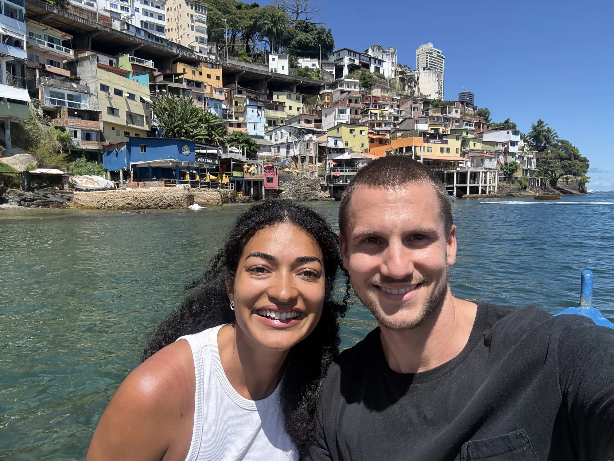
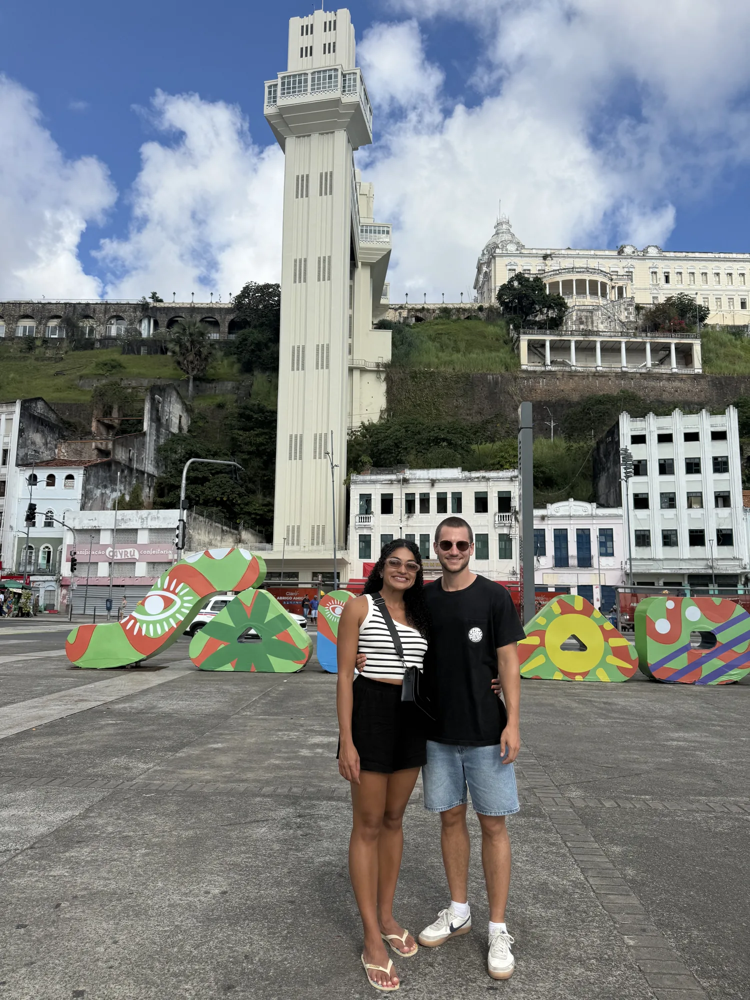
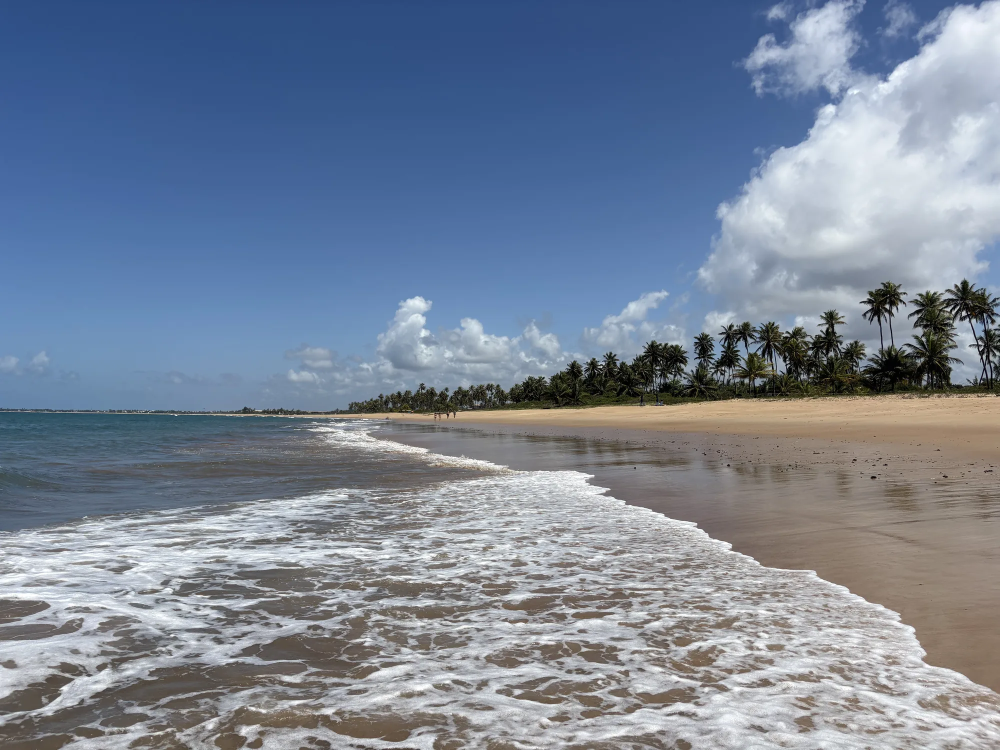
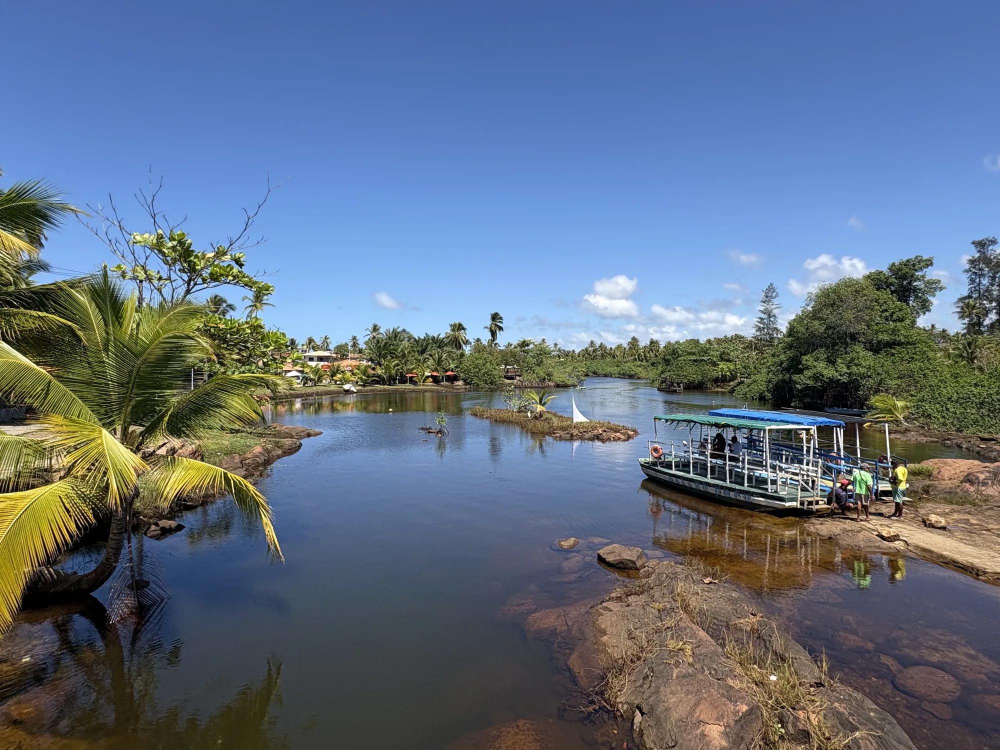
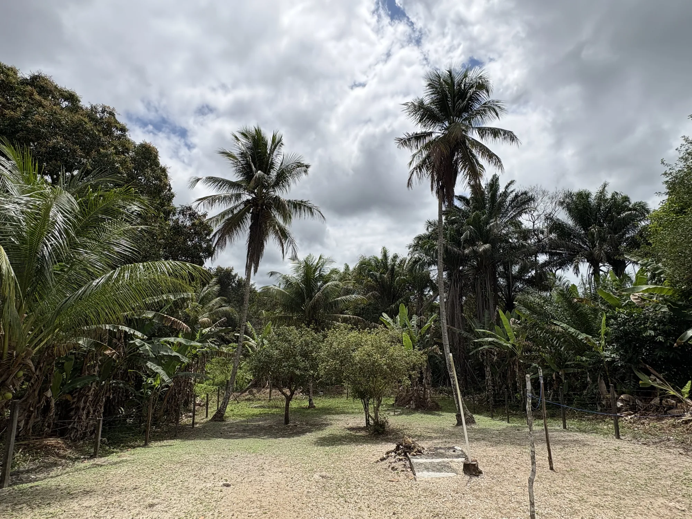
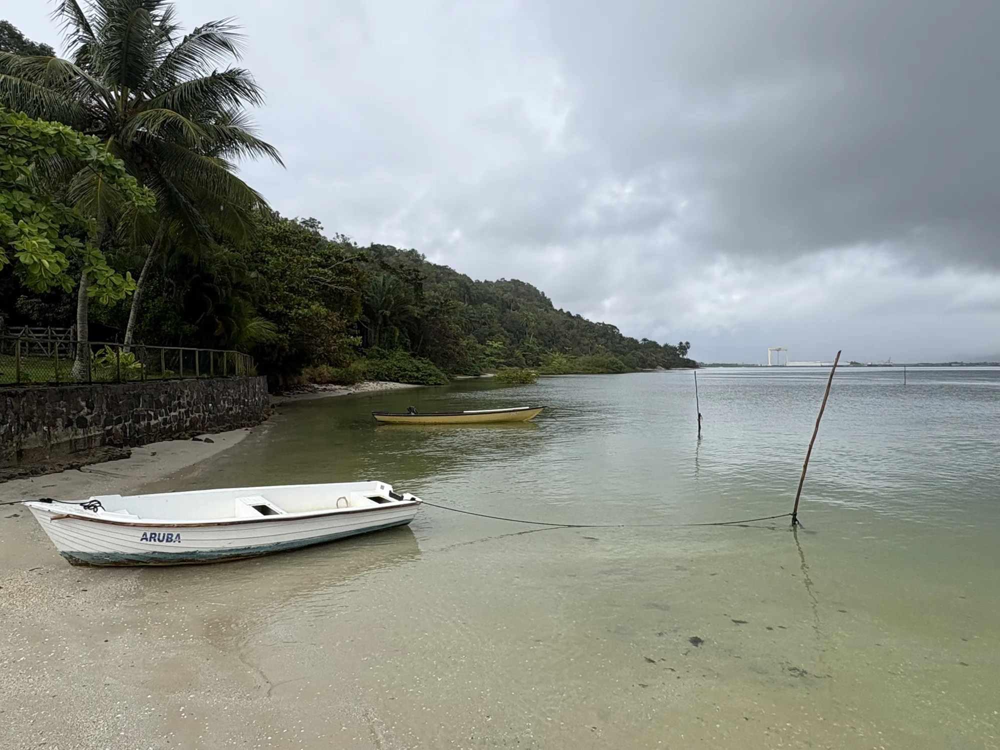
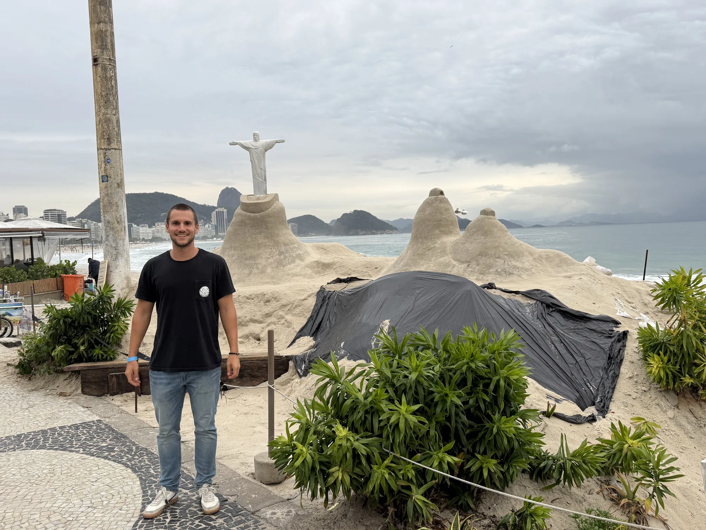
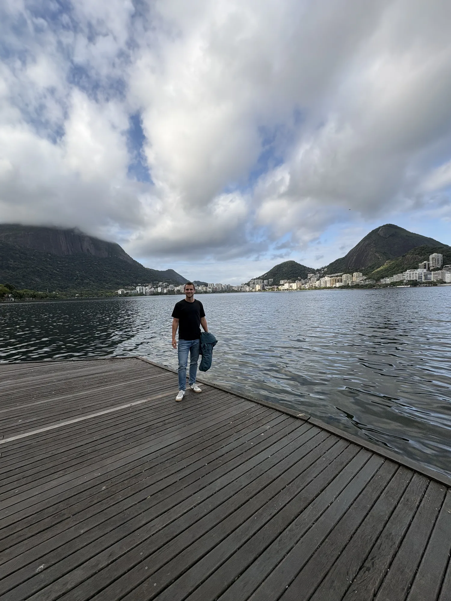
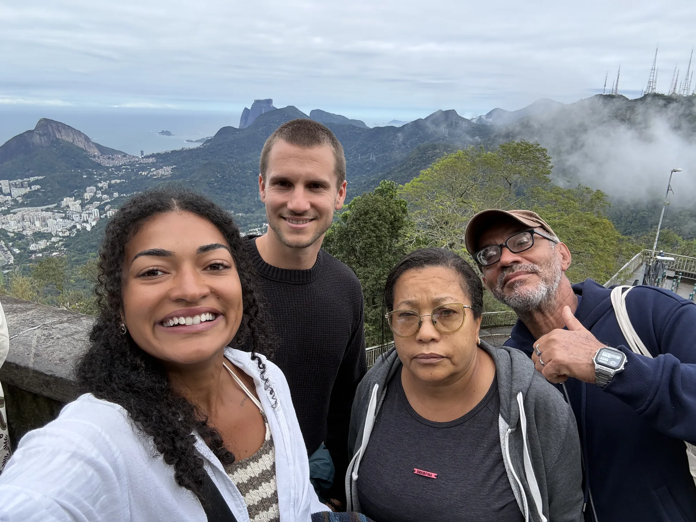

In August and September of 2026 I had the chance to travel to Brasil for the first time. My girlfriend is brasilian and she grew up there and here parents are still living there. We had a good mix of visiting family and friends, enjoying time as a couple in bahias beatufil places and traveling. We stayed two week ins Bahia and one week in Rio de Janeiro

## Salvador da Bahia

We stayed at her familys place, in Salvador the multi million capital of bahia. The city part is called Cabula. Probably nothing were you would go as a normal tourist. Its just a normal quarter where natives are living, no sightseeing, no leisure activities, just Bahia City life as it is. 

I met her parents already in germany once they visited us, but visiting them and staying at their place was definitly a more intense get to gether. I really like it and felt so warm welcome. I already miss the awesome food and dinners where my girlfriend played the dolmecher to keep us all involved. My portuguese has improved the last years but it is still not that good to really follow normal conversations for long time. And I am pretty sure her dad is talking some really heavy street slang :D. We also visited friends and grandma and celebrated the birthdas of my grildfriends nethew in thr local *freibad*. Being so integrated into local live mad this trip very special. I traveled to different countries and cultures but never that close to locas. 

*needs to be integrated above: Condomino (where the parents live), walkoing through it in the evening, kids playing, aduls talking to each other. although strange to have a wall around the condominio.*

What I liked most about the city: 

The historic old town *forgot the name, prop Pelourinho*. Walking through the quarter, small shops, historical buildings, churchs, great view on the atlantik from above. It is just not that clean and *hergerichtet* as you would have it in european old downtowns.

bar st monica. Local bar directly at the water. You go there by boat, to now walk through the favela close to it. We stayed until sundown (17:30, it is winter). Enjoyed coconut water, local beers and the water. What is strange, that people bring their own music. I think it is offically not allowed (anymore) but they still do. So you sit in between 3 groups where all of them try to play their brasilian *schlager musik, wie heißt die richtig von george & mateus zum beispiel* louder than the others. 

I liked the local gym. We always went very early. Nevertheless lots of people in there, usually more than in germany for the same size. It is common to share the exercise *Trainingsgerät* in between sets, so you automatically talk to people. I liked how they tried to talk to me. I think it is not usally in cabula to meet tourists. Something I recongnized: lots of young people are very religious. Havrnt recognized this somewhere else that itense yet. 

Farol do Barra. Probalbyl the nicest places and worth to visit for tourist. I can recommend to spend some time there during sundown. Lots of locals also spend their evening there, so prices are normal. You can go there for a run, along the coast. Lots of people are doing it. and lots of people are trying to take pictures from you in your best pose. You can support them for a little money and buy the picutes then online. I recommend Coco nut water and Acaii Ice cream with yout favorite toppings for the sundown. 

One evening we went to a local pagode. I can recommend to visit such a local event, although I dont really like the music. I do enjoy brasilian music but not the pagode one.

One thing I wont miss is the traffic. I mean I have experienced chaotic traffic yet in e.g. some asian big cities, but at leat they respect the rules. Salvador is defitnitly next level of chaos and noise.

  <figure>
    
    <figcaption>Together by the waterfront in Salvador</figcaption>
  </figure>
  <figure>
    
    <figcaption>In front of Elevador Lacerda</figcaption>
  </figure>

## Praia do Forte

We rented a car for a few days and drowve along the coast "linha verde" to a beatiful holiday place called praia do forte. It is one of the famous holiday places in Bahia where brailians spend their holidays too. Actually I haven't heard people not speaking portugues much. 

we stayed at *hostel praia do forte* which I can more than recommend. The Breakfast buffet is great. 

Directly, in praia do forte there are so many beatufiul restaurants that we havent had neough time to try everything. I think my favorte food to order is moqueca with camerao. In general it felt calm and relaxining, after a few days being in the city. Brasilian cities are loud, very loud, whole day and night.

We spend our days doing some exercise, walking along beatiful beaches closeby (Imbassai), visiting the local *schildkröten project von petrobras, was genau machen die*. 

We also visited the famous castelo there where portuges colocnist orignally arrived and explored the country from. Nothing special but I can recommned to go beofre closing and watch the *beamer* show. 

We walked through the *wald, naturschutzgebiet, wie hieß das nochmal. Prop Saipirranga* to explore the *mata altantica*. All the plants that we have in german as hip *Zimmerplanzen* are native there. 

  <figure>
    
    <figcaption>Beach near Praia do Forte</figcaption>
  </figure>
  <figure>
    
    <figcaption>Palm trees along the river</figcaption>
  </figure>

## Ilha de Itaparica

Back to Salvador after our stay in praia do forte, we went by ferry with our to Uhla de Itaparica. We stayed one night in Ourives. It's just two dozens of houses, a really small village. My girlfriends mother was born and raised there. The house is still there but no often used. We only stayed one night, but it was one more really special experience you wont have wuthout knowing any local. The whole village was interest about me and everyone let me try their special food and fruits. 

We had bad weather these day but nevertheless explored the island a bit. yet another contrast to the big 3 million people cuity and the nice holiday region in praia do forte. The island is simple, untouched, not much to do but some beatiful places and really happy habitants. I am really wondering what these people are doing all day long there. They would probably think the same when they would now my day to day. It really makes you quest parts of your life.

  <figure>
    
    <figcaption>Palm trees where we stayed</figcaption>
  </figure>
  <figure>
    
    <figcaption>A small boat by the shore</figcaption>
  </figure>

## Rio de Janeiro

The waeather in rio is different. Although we had Winter in bahia, we had mostly sunny days with 28 degrees celcius. In rio we had 10 degrees less and cloudy, often rainy days. I'll never come back to Rio ... in winter. Beside that we had a good time exploring the city in 5 days, which in my opinion is enough to see most of the famous places within the city.

Our hotel was in capacabano, so for sure we explored copacabana and ipanema beach. Although it is off season it is crowed in the evening with lots of food options and markets. Throughout the day, people are playing footvolei at the beach. Its basicall volleyball but without the hands, mainly playing with foods. They play really well. 

Most do, for sure is visiting Cristo. You can take a old *zahnradbahn* to drive through the forsts up to the hill of christo *whats the name of the hill*. Above you can try to take a picture without any other person on the foto, we failed. It was very crowed. Dont want to image how this in barsilians summer during holiday season. Nevertheless I enjoyed. Not much cristo, but the view over Rio. You are starting to understand the map of this big city.

The same day we also vitied a garden *what was the name* where you are sourrouned by the mata atalantic within the big city. It also has a lot of big Jackfruit trees. I somewhere heard that they got imported by indians. We thought about going into the botanic garden but it was really expensive for non-brasilians and we've had already been around a lot this day. 

Things also worth to visit is Santa teressa as a whole quater. You can use the historic tram to drive up the hill and then walk the quater hilldown. There are some beatifuls shops and caffes. Going down one can walk the famous 'escadas', very long stairs full of *fließen* from around the world created by *who*. Arc lapo is also known as a sightseeing spot, but in my opinion you do not miss anything not seeing it. 

Instead dont miss: Praia vermehlha, ingredbile beatiful *bucht* with a great view on the *Zuckerhut*. It was cloudy and we went there jst short after lots of city sughtseeing. I would have loved to take a *baden gehen*. 

For dinner, we went to differen churrasco places. Great food, but the really special once I enjoyed most whrer in bahia.

  <figure>
    
    <figcaption>Along the coast in Rio de Janeiro</figcaption>
  </figure>
  <figure>
    
    <figcaption>A cloudy day by the lagoon</figcaption>
  </figure>

  <figure>
    
    <figcaption>Above Rio with Christ the Redeemer in the background</figcaption>
  </figure>

I'd love to come back to brasil the next years. Bahia for sure agains most of the time, and then visit some other places. Probably amazonia the next time.

# notes to include 

## food
comida bahiana
cocido
farinha
farofa
wie hist das cremige aus der soße gemacht mit farinha?
sweet patatos, manioc, kochbanene all the time
chrussaco in rio. Nvertheless the best picanha, i grilled by myself in germany.
fruits, juices (goiaba, acerola, cacau, caju, ...)

## else
winter in bahia. sunny 28 degres celcius.
winter in rio, rainy 20 degress. 

drivin uber all the time, secure and affordable. thought strange quaters and streets in the evening when the main roads where blocked by traffic jam. 

