In August and September of 2026, I had the chance to travel to Brazil for the first time. My girlfriend is Brazilian and she grew up there. Her parents are still living on site. We had a good mix of traveling, visiting family & friends and enjoying time as a couple in Bahia's beautiful places. We had two weeks in Bahia and one week in Rio de Janeiro.

## Salvador da Bahia

We stayed at her family's place, in Salvador, the capital of Bahia with several million inhabitants. The city district is called Cabula. It's probably not somewhere you would go as a regular tourist. It's a normal quarter where locals are living, with no sightseeing or any special leisure activities, just Bahia city life as it is.

Her parents live in a so-called condomínio, where we could walk around in the evenings while kids were playing and adults were talking to each other in a safe area. It felt strange to me to have a wall around the whole condomínio, though.

I had already met her parents in Germany, but visiting them and staying at their place was definitely a more intense get-together. I really enjoyed it and felt so warmly welcomed. I already miss the awesome food and dinners where my girlfriend played the translator to keep us all involved. [My Portuguese has improved](/blog/how-to-learn-a-new-language/) over the last few years, but it is still not good enough to fully take part in normal conversations for a long time. And I am pretty sure her dad speaks some really heavy street slang ;-).

During the weeks, we also visited friends, her grandma's place and celebrated her nephew's birthday at one of the city's large outdoor swimming pools. Being so integrated into local life made this trip very special. I have traveled to different countries and cultures, but never been that close to locals.

I really enjoyed the Bahian food. Comida baiana, cozido and moqueca I liked the most. Lots of food comes with farofa and pirão. Sweet potatoes, manioc and plantains are on the table all the time. And there were so many fruits and juices I tried: goiaba, acerola, cacau, caju, just to name a few that I can remember by name.

One of the places I liked most in the city was the historic old town, Pelourinho. We walked through the quarter with small shops, historical buildings, lots of churches and a great view of the Atlantic. It is just not as clean and well-kept as European old towns.

  <figure>
    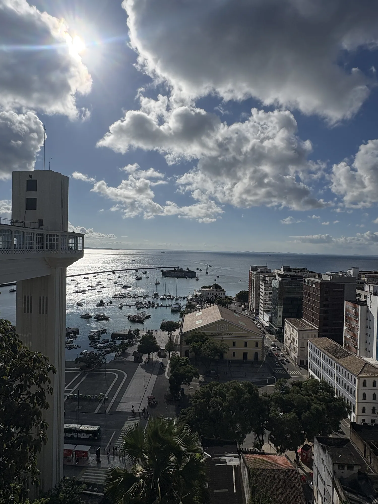
    <figcaption>The view from Salvador’s old town</figcaption>
  </figure>
  <figure>
    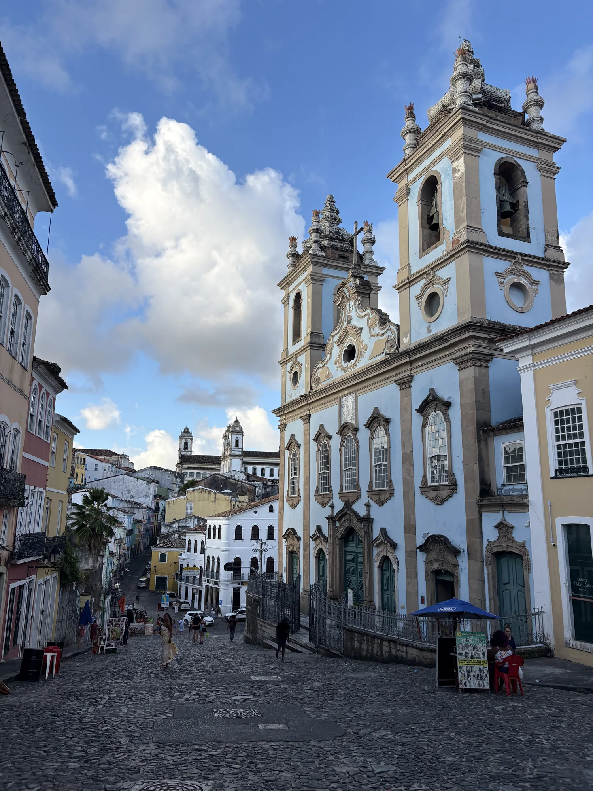
    <figcaption>Walking through the old town</figcaption>
  </figure>

Bar St. Monica is a local bar directly by the water. You go there by boat to avoid walking through the favela close to it. We stayed until sundown (17:30, it is winter in August), enjoying coconut water, local beers and the water. What is strange is that people bring their own music. I think it is officially not allowed anymore, but they still do it. So you sit in between 3 groups, all of them trying to play their Brazilian sertanejo music louder than the others.

  <figure>
    
    <figcaption>By boat to the waterfront bar</figcaption>
  </figure>
  <figure>
    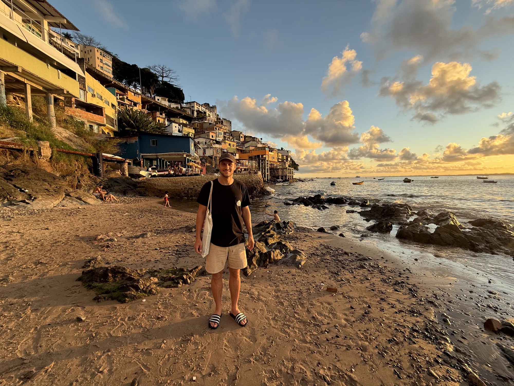
    <figcaption>The waterfront by the bar, just before sunset</figcaption>
  </figure>

I liked the local gym, where we always went very early in the morning. There were lots of people in there, usually more than in gyms of the same size in Germany, I would say. It is common to share the exercise equipment between sets, so you automatically talk to people. I liked how they tried to talk to me. I think it is not usual in Cabula to meet tourists. Something I noticed was that lots of young people are very religious. I haven't noticed this anywhere else that intensely yet.

Farol da Barra is probably one of the nicest places and worth visiting for tourists. I can recommend spending some time there during sundown. Lots of locals also spend their evenings there, so prices are normal. You can go there for a run along the coast, which lots of people do. I recommend coconut water and açaí ice cream with your favorite toppings for the sundown.

  <figure>
    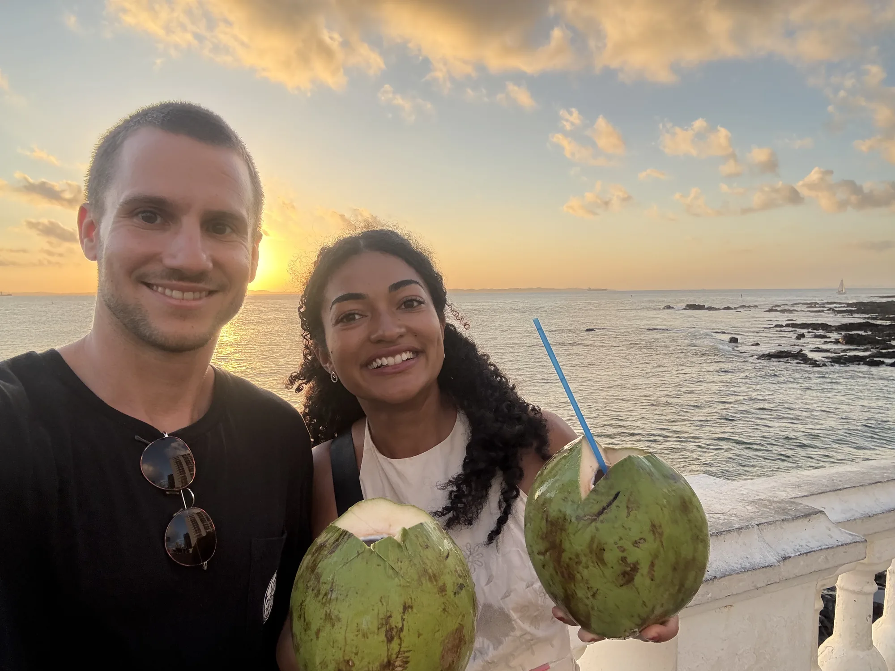
    <figcaption>Coconut water for the sunset</figcaption>
  </figure>
  <figure>
    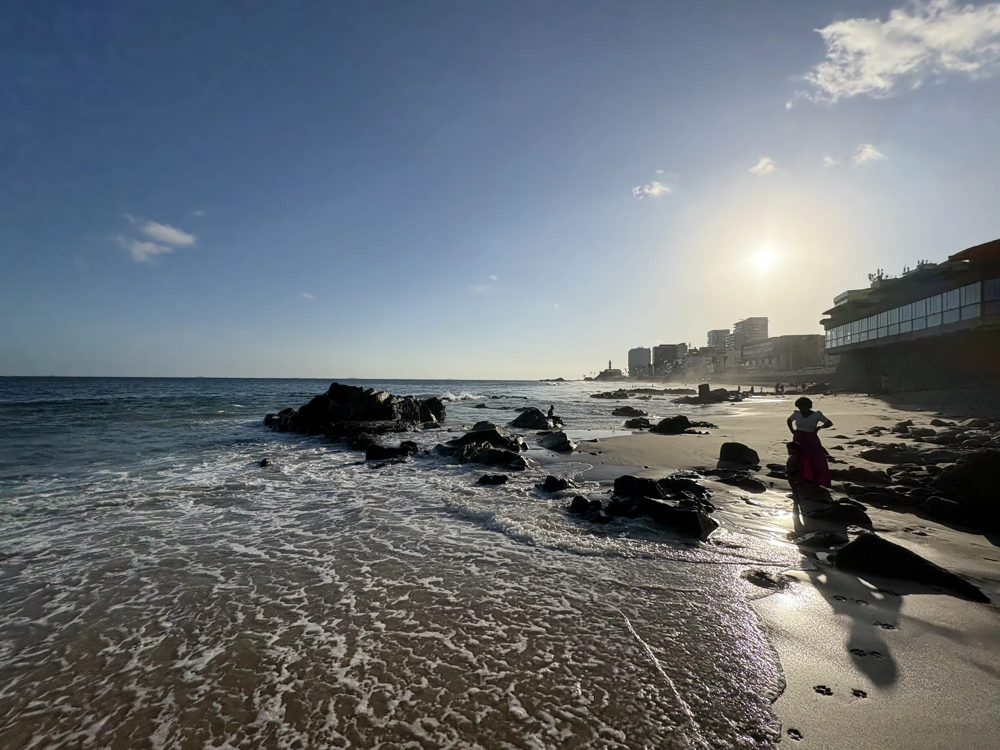
    <figcaption>Along the coast in Salvador</figcaption>
  </figure>
  <figure>
    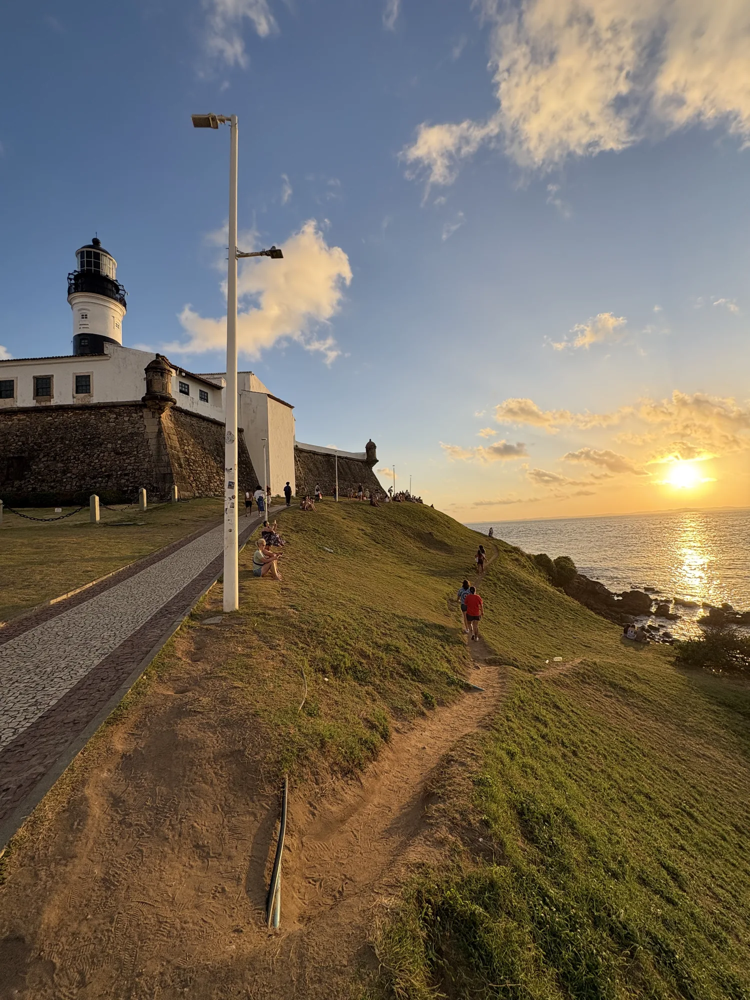
    <figcaption>Sunset at Farol da Barra</figcaption>
  </figure>

One evening we went to a local pagode. I can recommend visiting such a local event, although I don't really like the music. I do enjoy Brazilian music, but not pagode.

One thing I won't miss is the traffic. I mean, I have experienced chaotic traffic before, e.g. in some big Asian cities, but at least they respect the rules. Salvador is definitely the next level of chaos and noise.

## Praia do Forte

We rented a car for a few days and drove along the coast on the "Linha Verde" to a beautiful holiday place called Praia do Forte. It is one of the famous holiday places in Bahia where Brazilians spend their holidays too. Actually, I didn't hear people speaking anything other than Portuguese much.

We stayed at [Hostel Praia do Forte](https://praiadofortehostel.com.br/), which I can more than recommend. The breakfast buffet is great.

Directly in Praia do Forte there are so many beautiful restaurants that we didn't have enough time to try everything. I think my favorite food to order is moqueca de camarão. In general, it felt calm and relaxing after a few days in the city. Brazilian cities are loud, very loud, all day and night.

We spent our days doing some exercise, walking along beautiful beaches both in Praia do Forte and close by in Imbassaí.

  <figure>
    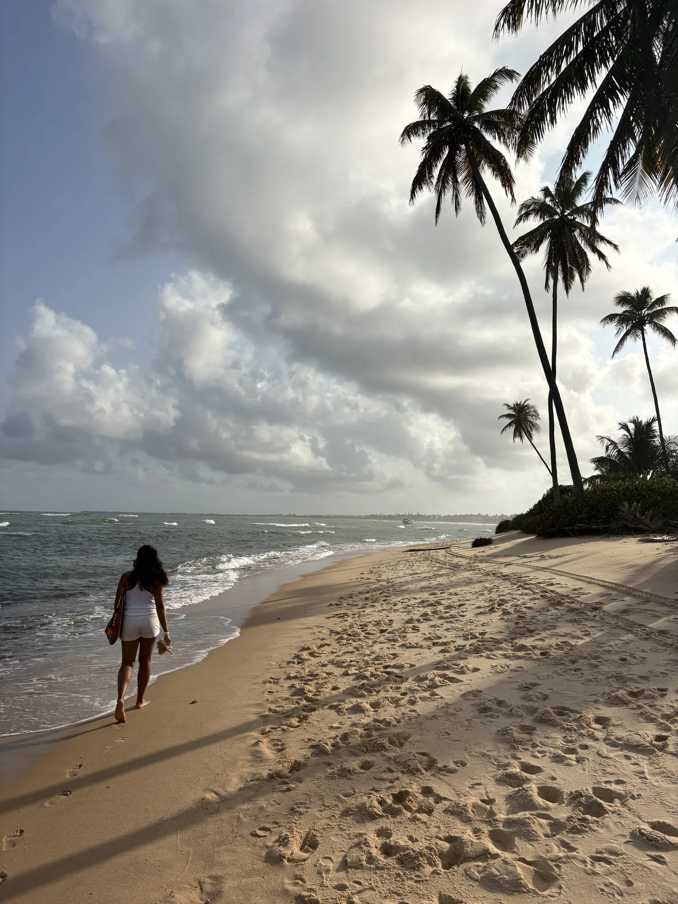
    <figcaption>A walk along the beach</figcaption>
  </figure>
  <figure>
    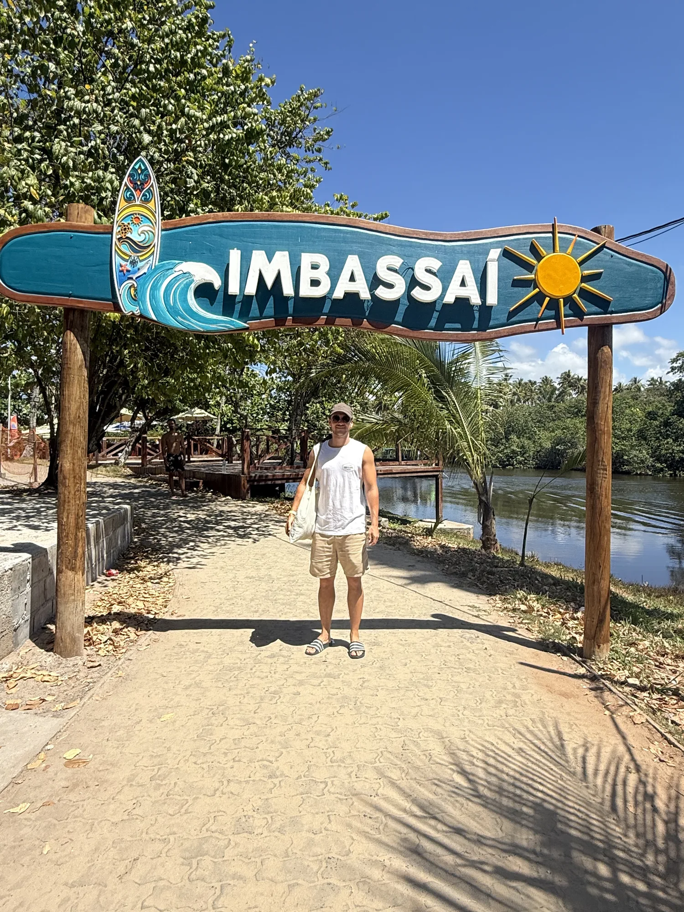
    <figcaption>Exploring Imbassaí</figcaption>
  </figure>

  <figure>
    
    <figcaption>By the river in Imbassaí</figcaption>
  </figure>

We also visited the famous castle there (Castelo Garcia d’Ávila), a fortification from the Portuguese colonial period. It was nothing special, but I can recommend going before closing and watching the projection show in the dark.

We walked through Sapiranga, a nature reserve just around the corner, to explore the Mata Atlântica. I recognized plants that we keep as houseplants in Germany.

  <figure>
    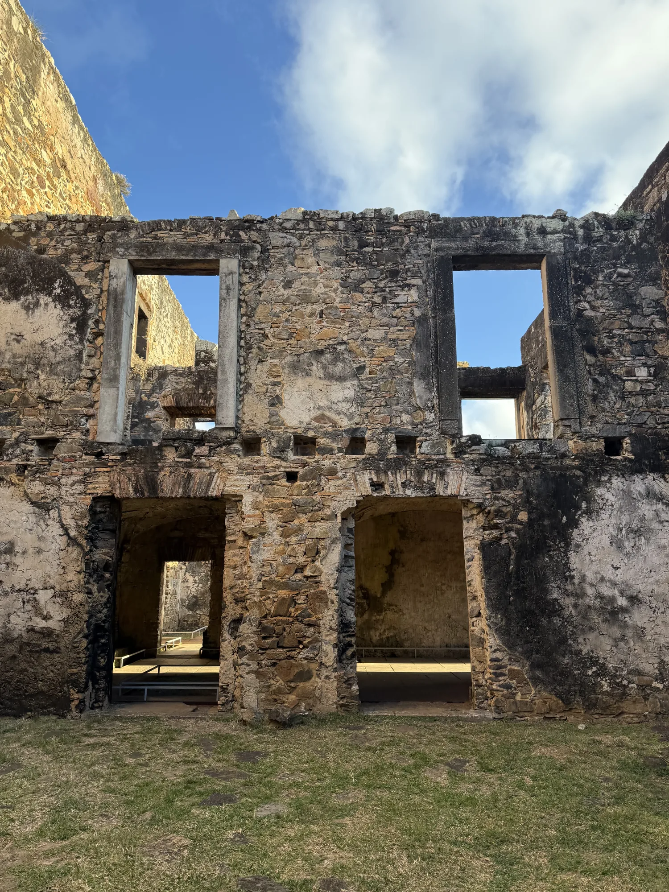
    <figcaption>Exploring the castle ruins</figcaption>
  </figure>
  <figure>
    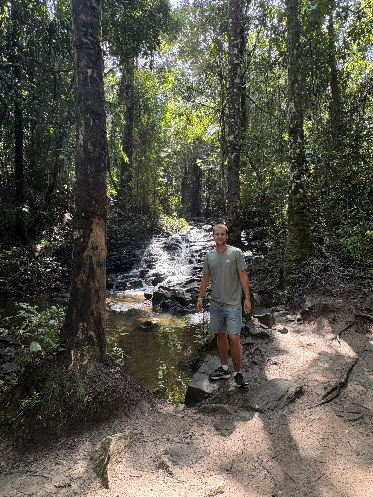
    <figcaption>In the Mata Atlântica</figcaption>
  </figure>

## Ilha de Itaparica

Back in Salvador after our stay in Praia do Forte, we went by ferry with our car to Ilha de Itaparica. We stayed one night in Ourives, a really small village of just two dozen houses where my girlfriend's mother was born and raised. The house is still there, but not often used. We only stayed one night, but it was one more really special experience you wouldn't have without knowing any locals. The whole village was interested in me, and everyone let me try their special food and fruits.

We had bad weather during those days, but nevertheless explored the island a bit. It was yet another contrast to the big city of 3 million people and the nice holiday region in Praia do Forte. The island is simple and untouched, with not much to do, but some beautiful places and happy inhabitants. I wonder what these people are doing all day. They would probably think the same if they knew my day-to-day life. It really makes you question parts of your life.

  <figure>
    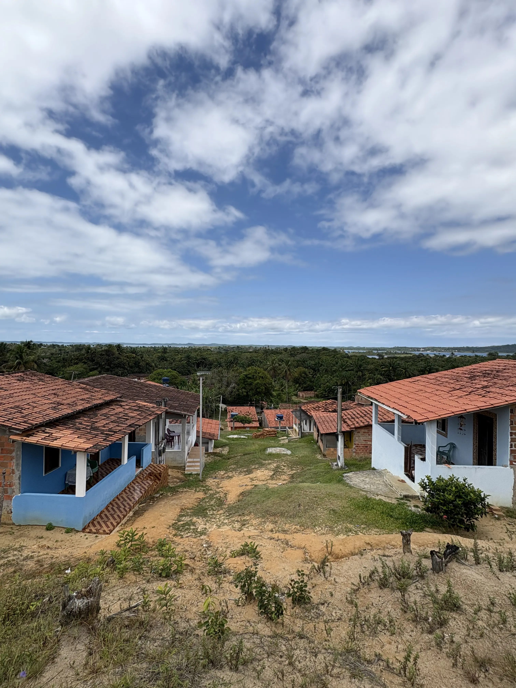
    <figcaption>Village life on Itaparica</figcaption>
  </figure>
  <figure>
    
    <figcaption>A quiet shore on Itaparica</figcaption>
  </figure>

## Rio de Janeiro

The weather in Rio is different. Although it was winter in Bahia, we had mostly sunny days with 28 degrees Celsius. In Rio it was around 20 degrees, with cloudy, often rainy days. I'll never come back to Rio ... in winter. Besides that, we had a good time exploring the city in 5 days, which in my opinion is enough to see most of the famous places within the city.

Our hotel was in Copacabana, so for sure we explored Copacabana and Ipanema beaches. Although it was off-season, it was crowded in the evening with lots of food options and markets. Throughout the day, people were playing footvolley at the beach. It's basically volleyball but without the hands, mainly playing with feet. They play really well!

A must-do, for sure, is visiting Cristo. You can take an old cog railway through the forests up to the hill of Cristo. Up there you can challenge yourself to take a picture without any other person in the photo. We failed. It was very crowded. I don't want to imagine how this is in the Brazilian summer during the main season. Nevertheless, I enjoyed it, not so much for Cristo, but for the view over Rio.

  <figure>
    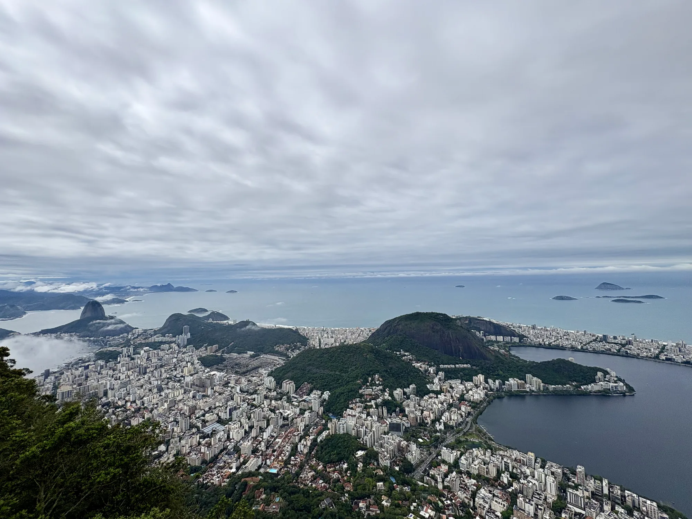
    <figcaption>The view over Rio</figcaption>
  </figure>

The same day we also visited a garden (Parque Lage) where you are surrounded by the Mata Atlântica within the big city. It also has a lot of big jackfruit trees. They were introduced to Brazil by the Portuguese. We also thought about going into the botanical garden the same day, but it was really expensive for non-Brazilians, and we'd already been around a lot.

Also worth visiting is the whole historic quarter of Santa Teresa. You can use the old tram to go up the hill and then walk through the quarter downhill. There are some beautiful shops and cafés. Going down, you can walk down the famous 'Escadaria Selarón', 215 steps with more than 2,000 tiles from around the world. Arcos da Lapa is also known as a sightseeing spot, but in my opinion you do not miss anything by not seeing it.

  <figure>
    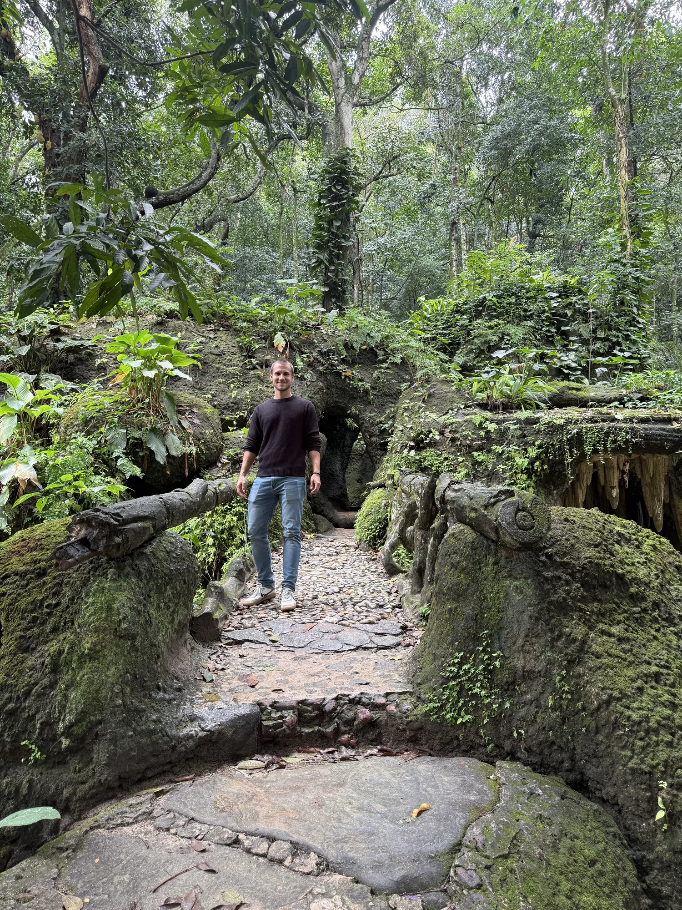
    <figcaption>A green break from the city</figcaption>
  </figure>
  <figure>
    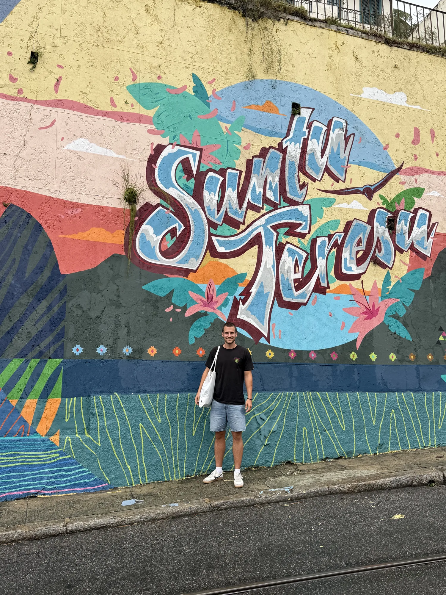
    <figcaption>Walking through Santa Teresa</figcaption>
  </figure>

Instead, don't miss Praia Vermelha, an incredibly beautiful bay with a (normally) great view of Sugarloaf Mountain. It was cloudy, and we went there just after lots of city sightseeing. I would have loved to go for a swim.

For dinner, we went to different churrasco places with great food, but the really special ones I enjoyed most were in Bahia. In the end, I think the best picanha I've had was the one I grilled myself in Germany :-).

I'd love to come back to Brazil in the next few years and spend most of the time in Bahia again for sure. Then I'd like to visit some other places, probably Amazonia next time. For now, I am deeply grateful for this special experience.

  <figure>
    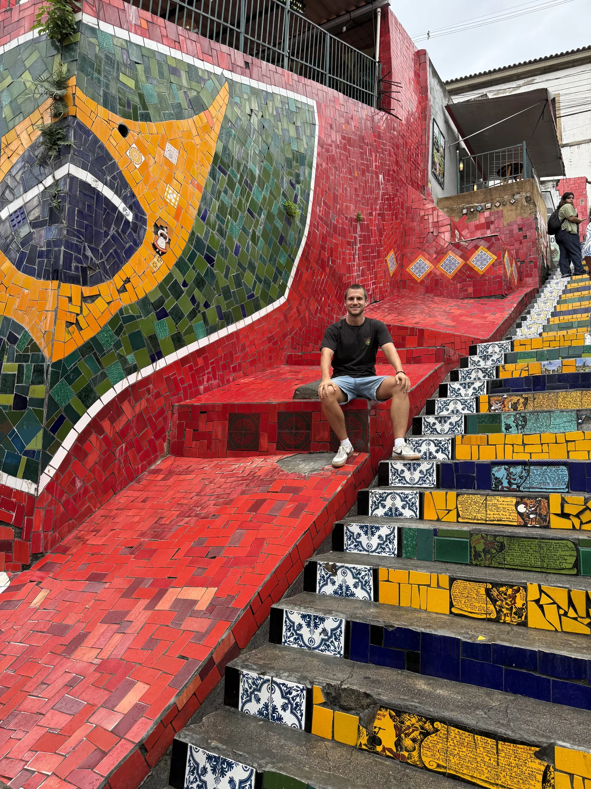
    <figcaption>The tiled steps in Rio</figcaption>
  </figure>
  <figure>
    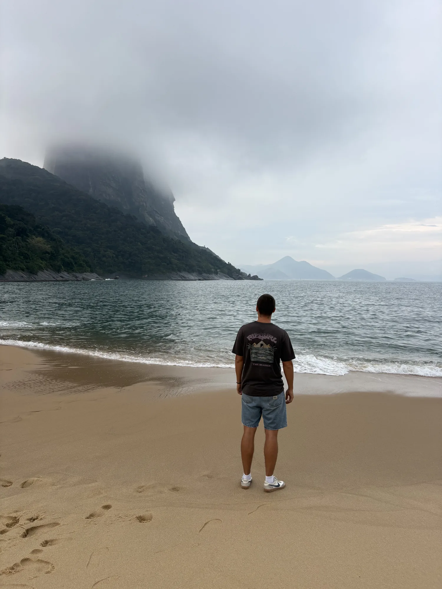
    <figcaption>Praia Vermelha on a cloudy day</figcaption>
  </figure>

